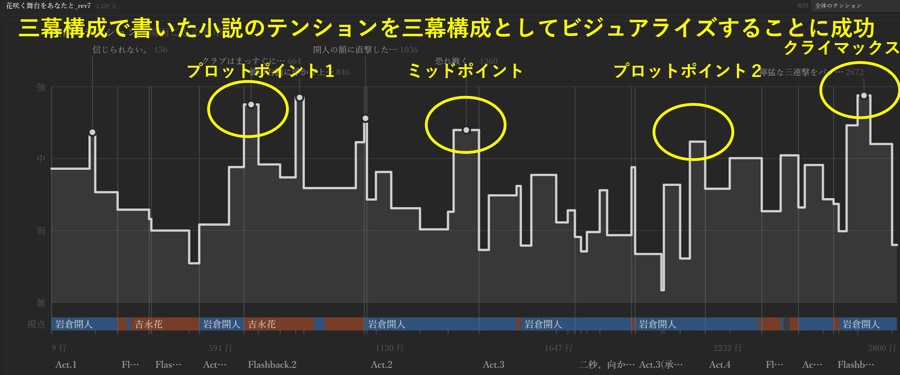

小説の原稿の三幕構成・テンションをチェックするためのツール（Obsidianのプラグイン）を作りました。
原稿を一文ずつ分けて、それぞれの文の「役割・話者・緊張度・人物ごとの感情」をAIに判定させて、タイムラインとして可視化します。
判定にはJevを用いているのが特徴です。JevはClaude・Codex（ChatGPT）・ローカルLLMよりも爆裂に高速・安価なのが特長。


原稿のテンションをリアルタイムに眺めつつ直せるのって案外に便利。
この前の直しでも、冒頭をちょっとテンション上げたり、クライマックスをテコ入れしたりしました。
そういう感じの使い方です。
今は、このツールを遊び倒すために新しい小説を書きたくなるなどしています。
手段の目的化、あるあるです。

さて、私自身は小説を三幕構成で書くというか三幕構成でしか書けないのだが、自分の小説が自分の意図通りの構成として読者に読まれているかどうかは別問題。
ときに、AIって多数決のツールゆえに多数派の素直な読みをしてくれるので、AIは多数派の読者として想定できる。
また、あるある話として「小説を上手くなるにはプロになるのが一番早い（編集者がつくので）」みたいな話がある。
ここで言うところの「編集者」って、多数派の読者だったり要するに「作者とは別の読み手」ってニュアンスだと思ってる。
編集者のプロフェッショナルって、ここで想像されるニュアンスよりも高い水準にあると期待しているのだけれど、さておき、ないものねだりをしても仕方ない。
自分で手の届く範囲で得られるものを得ようとしたらこうなった、という次第。

まあ、一次で落ちたら「俺のデータ小説が通用しないだとッ！！！」って喚きます。
