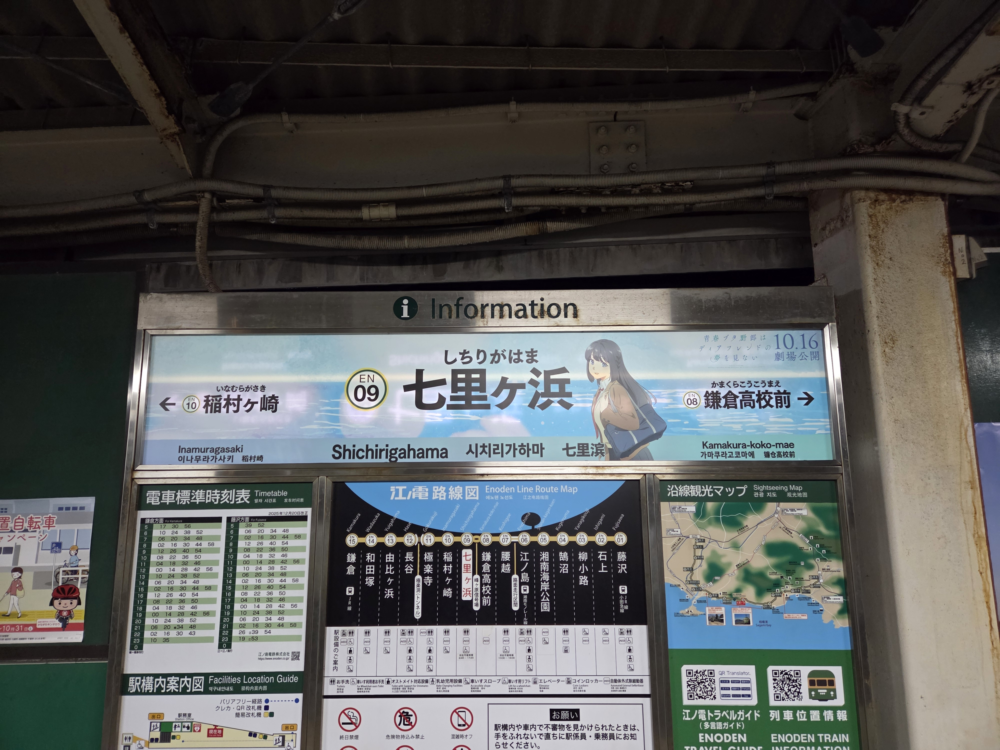

## 目次

１．２０２６年１０月のまとめ

２．２０２６年１０月に読んだ本（４冊／年間９０冊）

３．２０２６年１０月に聴いたジャズ（３枚／年間３８枚）

## １．２０２６年１０月のまとめ

### １．１．『青春ブタ野郎』シリーズ

１０月前半は、１６日に公開の映画『青春ブタ野郎はディアフレンドの夢を見ない』ためににフルベット。
映画に向けてテレビシリーズの高校生編１話から大学生編の最後まで観直して、テンションを作り込んでいました。
以下、初見時の感想。
私は大学生編の原作については否定的な立場を取ってきたが、今作、総合芸術であるアニメーションとしてよく演出されていた。なんだかんだ言いながら付き合ってきて、良かった。アニメスタッフにありがとうを言いたい。
特に音楽。霧島透子の音楽を象るfox capture planが完璧だった。浮遊感のあるサウンドは、現実の書き換わる地に足の付いていない世界を生み出していた。「Turn The World Upside Down」の一音目が本当に良く……。映画館で震えた。
ストーリーについては原作からして無理があり、その部分は変えようがなかったが、見せ方ですよね。どの声優さんもプロの仕事だったが、とりわけ美東役の石見舞菜香さんの、カラッとしつつも陰影のある演技。魅力的だった。
群像劇としての青ブタで言えば、咲太が「自分探し」する一連のシーケンスはアニメの集大成でしたね。誰かと会う、話す、それだけなのだが魅せてた。私自身は古賀ちゃんのファンなので彼女との最後のやり取りで一気にグッと来たというか、あのシーケンスのボスラッシュ性ですよね。本当の本当に最後だと思うと泣けてしまって。
アニメの力を信じて良かった。
ありがとう……。




### １．２．トレーディング

現状のシステムはかなり順調に動いています。
１０月に読んだ『潜在クラス分析』（Allan L. McCutcheon）はアイデアの宝庫だと思ったんですが（そして、実際、面白いデータは出てきたんですが）、収益化に至るにはあと１０倍の精度？が必要っぽくて、上手くいかず。まあ、いいトライをできた。

### １．３．仕事

現職：世界の大勢また我に利あらず
転職：捨てる神ばかりだが、今日（１１月２日）に**拾う神もいました。** 一次面接、突破。

### １．４．本

**『風姿花伝・三道』（世阿弥）** が面白いね。たぶん、次の小説の元ネタの一つになります。

### １．５．ジャズ

９月は石若駿。１０月は中村海斗。ドラマーの月でした。

## ２．２０２６年１０月に読んだ本

**①『現代語訳　風姿花伝・三道』（世阿弥　岡田利規・訳）**
世阿弥って凄いっす。
『風姿花伝』って、能に関して600年前に書かれた（一種の）マニュアルなんですが、時代が下って2026年になって読んでも、何かを演じること・何かを作ることの本質は変わらないのだとわかる。すみません、堂々と書きますが、次の本ではこれが種本の一冊になります。
あと、現代語訳は町田康風味なところがあり読みやすい。

**②『潜在クラス分析』（Allan L. McCutcheon）**
シストレのアイデアのために。常々、東証33業種はメッシュとして粗いと考えていた。33業種のそれぞれの中でも連動する銘柄もあれば、そうでない銘柄もある。業種を越えて連動する銘柄もある。また、業種とは別に細かいタグを用いる手もあるが、じゃあタグはどう用意するんだ、どう設定するんだ、時代と共にタグも変わるし……と問題は尽きない。
本書の「潜在クラス分析」は、私のその課題感に答えを持ってきてくれた。
潜在クラス分析のポイント：どのクラスに属するのかは「ハードな」0/1ではなく「ソフトな」確率によって決まる。例えば、特定の人物が普遍主義に属する確率は0.9、特殊主義に属する確率は0.7……といったように。逆に、同様の動きをする対象を同じクラスとして括り直すこともできる。
このポイントこそが私がまさに求めていたソリューションだった。今回、本書のアイデアを元に戦略を組み上げることはできなかったが、手札は確実に一枚増えた。いつでも取り出せるようにしておこう。

**③『エレガンス入門』（中野香織）**
途中まででギブ（語り口がどうしても合わなかった）。エレガンスとは選び抜くことらしいです。

**④『ファクター投資入門』（アンドリュー・L・バーキン）**
斜め読み。今の私にはもう不要かな。シストレって、私の直感だと、普遍性から離れたところからリターンを得ようとする試みだと思ってて、本書のように時代に依らず堅牢なファクターって、実は対極なのかもしれない。
## ３．２０２６年１０月に聴いたジャズ

**①『There Is Beauty, There Already』（Sarathy Korwar）**
インド系のジャズミュージシャン、サラシー・コルワルの最新作。打楽器にうねりがある。ちょうど最近は石若駿、中村海斗あたりの日本人ジャズドラマーを聴いていたので、彼らとのカルチャーの違いに驚く。

**②『BLAQUE DAWN』（中村海斗）**
よい……。
https://note.com/elis_ragina/n/nfdf32ed8aaf4

**③『Neon Chapter』（BIGYUKI）**
シンセサイザー奏者、BIGYUKIがリーダーの一枚。こういう電子音楽バリバリの音楽もジャズに分類されるのって面白いよな（確かにジャズである）。BIGYUKIはこのインタビューも面白いね。
https://wired.jp/article/bigyuki-johnconnor/

（おわり）

